# 药学专业知识一2026通关秘籍

【考点 1】药物剂型的重要性：①改变药物作用性质②调节药物的作用速度③降低或消除不良反应④具有靶向作用【但不能改变药物的作用靶点】⑤提高药物稳定性⑥影响疗效

【考点 2】药用辅料的作用：①赋型（稀释剂、黏合剂）；②使制备过程顺利进行（润滑剂）；③提高药物稳定性（抗氧剂）；④提高药物疗效（肠溶包衣）；⑤降低药物不良反应（芸香草油肠溶滴丸）；⑥调节药物作用（缓控释包材）；⑦增加病人用药的顺应性（矫味剂）

【考点 3】易水解的结构：内酯结构【普鲁卡因、阿托品】；酰胺结构【青霉素、头孢类、氯霉素、巴比妥类】

【考点 4】易氧化药物：肾上腺素、左旋多巴、吗啡【具有酚羟基】、维生素 C【具有烯醇基】

【考点 5】异构化反应：维生素 A易氧化，也发生几何异构化

【考点 6】聚合反应：氨苄西林钠、塞替派在水溶液中发生聚合

【考点 7】脱羧反应：对氨基水杨酸钠

【考点 8】影响制剂的【处方】因素：溶剂、pH、离子强度、赋形剂、金属离子络合剂

【考点 9】影响制剂的【非处方】因素：温度、光线、水分、空气、包装材料、金属离子

【考点 10】抗氧剂：【适合偏酸性药】焦亚硫酸钠/亚硫酸氢钠；【适合偏碱性药】亚硫酸钠/硫代硫酸钠【油溶性抗氧剂】叔丁基对羟基茴香醚（BHA），2，6-二叔丁基对甲酚（BHT）、维生素 E

【考点 11】①凡例是对正文、通则与药品质量检定的有关共性问题的统一规定，是药品质量检定的基本原则，具有法定的约束力。②通则是对药品质量指标的检测，包括药品的性状、鉴别、检查与含量测定等涉及的技术方法或指导原则的统一规定。

【考点 12】中国药典构成：一部：收载中药，包括药材和饮片，植物油脂和提取物，成方制剂和单味制剂二部：收载化学药品；三部：收载生物制品；四部：收载通则和药用辅料

【考点 13】崩解时限检查：普通片【15min】，分散片、可溶片【3min】，舌下片/泡腾片【5min】，薄膜衣片【30min】，糖衣片【60min】，硬胶囊【30min】，软胶囊【60min】，滴丸剂【30min】，口崩片【60s】

【考点 14】特殊杂质检查法：阿司匹林中的“游离水杨酸”；对乙酰氨基酚中的“对氯苯乙酰胺”；盐酸普鲁卡因中的“对氨基苯甲酸”；异烟肼中的“游离肼”；硫酸阿托品中的“莨菪碱”；青霉素钠中的“青霉素聚合物”；肾上腺素中的“酮体”

【考点 15】凡规定检查溶出度、释放度和分散均匀性的制剂不再进行崩解时限检查；凡检查含量均匀度的制剂一般不再检查重量差异

【考点 16】标准品—用于生物检定或效价测定的标准物质，量值按效价单位（U）或重量单位（μg）计；对照品—采用物理化学方法进行鉴别、检查或含量测定时使用的标准物质，量值一般按照纯度计。

【考点 17】密闭、密封、熔封或严封区别：密闭：将容器密闭，以防止尘土及异物进入；密封：将容器密封以防止风化、吸潮、挥发或异物进入；熔封或严封：将容器熔封或用适宜的材料严封，以防止空气与水分的侵入并防止污染。

【考点 18】密封适用于有引湿性或遇湿气易水解的药品、具有挥发性或易风化的药品的包装
例如：乙琥胺、阿司匹林、水合氯醛、氨茶碱

【考点 19】温度范围：阴凉处：温度不超过 20℃；凉暗处：避光并温度不超过 20℃：冷处：温度为 2-10℃；常温：温度为 10-30℃

【考点 20】静脉用注射剂，均应设细菌内毒素（或热原）检查项；化学药注射剂一般首选细菌内毒素检查项中药注射剂一般首选热原检查项

【考点 21】细菌内毒素或热原检查：利用鲎试剂（或家兔）测定供试品所合的细菌内毒素（或热原）的限量是否符合规定

【考点 22】①加速试验：可预测药品有效期，在温度 40℃±2℃，相对湿度 75％±5％的条件下放置 6 个月。②高温试验的温度高于加速试验 10℃以上，如 60℃±2℃。高湿试验（相对湿度 90％±5％）。③长期试验（留样观察法）：确定药品有效期，在接近药品的实际贮藏条件下进行，3 个月取样一次。

【考点 23】体内药物检测中最为常用的样本是血液

【考点 24】共价键【强而持久，不可逆结合形式】：

①烷化剂类抗肿瘤药物（环磷酰胺、美法仑）②β-内酰胺类抗生素药物③拉唑类抗溃疡药物

【考点 25】离子键（最强）:①去甲肾上腺素与β肾上腺素受体②氯贝胆碱与 M胆碱受体

【考点 26】氢键：磺酰胺类利尿药、碳酸通过氢键和碳酸酐酶结合

【考点 27】离子-偶极作用（羰基）：镇痛药美沙酮

【考点 28】【抗疟药氯喹】键合类型：电荷转移复合物

【考点 29】非共价键键合方式中最弱的：范德华力

【考点 30】第Ⅰ类药物【高溶解度、高渗透性】：吸收取决于溶出度【普萘洛尔、依那普利、地尔硫䓬】

【考点 31】第Ⅱ类药物【低溶解度、高渗透性】：吸收取决于溶解度【卡马西平、双氯芬酸、吡罗昔康】

【考点 32】第Ⅲ类药物【高溶解度、低渗透性】：吸收取决于渗透率【雷尼替丁、阿替洛尔、纳多洛尔】

【考点 33】第Ⅳ类药物【低溶解度、低渗透性】：吸收困难【呋塞米、特非那定、酮洛芬】

【考点 34】药物亲水性或亲脂性大小用脂水分配系数（P 或 lgP）表示，P值越大，脂溶性越高；但脂溶性不是越大越好，只有合适的脂溶性，药物才具有最佳活性。

【考点 35】增加水溶性的官能团：羟基、季铵（不易透过生物膜和血-脑屏障，口服吸收差，无中枢作用）

【考点 36】增加脂溶性的官能团：烃基、卤素、酯环、硫原子、烷氧基等

【考点 37】增加酸性的官能团：-COOH（羧基），-SOH（磺酸基）

【考点 38】①苯环羟基化：苯妥英、保泰松、氯丙嗪、华法林、普萘洛尔。②卡马西平、己烯雌酚：烯烃氧化。③阿苯达唑—硫醚氧化；硫喷妥—氧化脱硫生成戊巴比妥。④普萘洛尔：芳环的对位发生羟基化、氧化脱胺、N-脱烷基；⑤氯霉素：硝基还原、脱卤素。⑥水解反应：普鲁卡因、丙胺卡因。

【考点 39】对映异构体之间具有等同的药理活性和强度：普罗帕酮、氟卡尼

【考点 40】一种对映体具有药理活性，另一对映体具有毒性：氯胺酮、乙胺丁醇、左旋多巴

【考点 41】对映异构体具有相同的药理活性，但强弱不同：萘普生、氧氟沙星、氯苯那敏

【考点 42】对映异构体产生相反的活性：哌西那朵（哌西那多）、扎考必利、异丙肾上腺素

【考点 43】对映异构体产生不同类型活性：【奎宁-奎尼丁】 【右丙氧芬-左丙氧芬】

【考点 44】对映异构体一个有活性，一个没活性：甲基多巴、氨己烯酸

【考点 45】亦称为官能团化反应【I 相代谢】：氧化、还原、水解、羟基化等

【考点 46】Ⅱ相结合反应：①与葡萄糖醛酸发生结合：吗啡、氯霉素；②与谷胱甘肽发生结合：白消安；③与硫酸发生结合：沙丁胺醇；④发生甲基化结合：肾上腺素；⑤发生乙酰化结合：对氨基水杨酸

【考点 47】Ⅱ相代谢中极性减小的反应:甲基化结合反应、乙酰化结合反应

【考点 48】地西泮代谢生成奥沙西泮:N-脱甲基和α-碳原子羟基化

【考点 49】氯霉素产生毒性的根源:二氯乙酰基侧链代谢氧化后生成酰氯，能与 CYP450 酶等中的脱辅基蛋白发生酰化

【考点 50】舒林酸属前体药物，体外无效，进入体内后经还原代谢，生成硫醚类活性代谢物发挥作用

【考点 51】芳环药物的氧化代谢：保泰松【体内代谢成羟布宗】

【考点 52】烯烃类药物代谢生成环氧化合物:卡马西平 I 相代谢

【考点 53】含饱和碳原子药物的氧化代谢丙戊酸钠【发生ω和ω-1氧化】

【考点 54】药物与非治疗部位靶标结合产生的副作用：

①氯丙嗪、氯普噻吨：引起锥体外系反应；②罗非昔布/伐地昔布：引起心血管不良反应

【考点 55】药物与非治疗靶标结合产生的副作用：

①氯氮平、利培酮：既阻断 DA 受体，又阻断 5-HT 受体；②卡托普利、依那普利：同时阻断缓激肽分解③红霉素、罗红霉素：刺激胃动素的分泌

【考点 56】罗非昔布引起血栓原因：破坏了 TXA 与 PGI 的平衡，从而增强了血小板聚集与血管收缩，引发血管栓塞事件

【考点 57】氯氮平、利培酮既阻断 DA 受体，又阻断 5-HT 受体，锥体外系反应降低

【考点 58】抑制 hERG K+通道，出现心律失常：地高辛、依巴斯汀、氯雷他定、多潘立酮、特非那定、酮康唑、阿司咪唑等

【考点 59】普拉洛尔【已撤市】：在体内的代谢活化首先生成 O-去烷基化生成化合物，继之氧化生成亚胺-醌式结构化合物，引起特质性硬化性腹膜炎

【考点 60】舒多昔康：临床Ⅲ期表现出严重肝毒性被终止开发

【考点 61】服用对乙酰氨基酚后饮酒，引起肝毒性的原因是：对乙酰氨基酚在体内经 CYP2E1 代谢产生氢醌，产生毒性增加。

【考点 62】苯二氮䓬类 A环上 7 位引入吸电子取代基时，活性明显增强

【考点 63】苯二氮䓬类的 1,2 位骈上三氮唑环【代表药物艾司唑仑、阿普唑仑】,增加 1，2 位的稳定性，代谢稳定，提高药物与受体亲和力，作用增强

【考点 64】地西泮经3 位羟基化，代谢为替马西泮，再 1 位 N-去甲基代谢为奥沙西泮【1 位 N-去甲基，3 位引入羟基】

【考点 65】非苯二氮䓬类药物:咪唑并吡啶结构药物【唑吡坦】;吡唑并嘧啶【扎来普隆】;【佐匹克隆】结构中含有
一个手性中心；右旋体为艾司佐匹克隆，具有很好的短效催眠作用，而左旋体无活性，且易引起毒副作用

【考点 66】氯丙嗪光敏毒性的原因：遇光分解，生成自由基并与体内蛋白质作用，发生过敏反应

【考点 67】利培酮的活性代谢产物：帕利哌酮

【考点 68】根据拼合原理设计的药物;利培酮、齐拉西酮

【考点 69】硫杂蒽类：根据生物电子等排原理，用碳原子替换吩噻嗪母核上的 10 位氮原子，并通过双键与碱性侧链相连

【考点 70】吩噻嗪类抗精神病药：氯丙嗪、奋乃静、氟奋乃静

【考点 71】硫杂蒽类抗精神病药：氯普噻吨、珠氯噻醇、氟哌噻吨

【考点 72】单胺氧化酶抑制剂：吗氯贝胺、托洛沙酮

【考点 73】选择性 5-羟色胺再摄取抑制药：西酞普兰、氟伏沙明、氟西汀、去甲氟西汀、舍曲林、帕罗西汀

【考点 74】5-羟色胺与去甲肾上腺再摄取抑制药：文拉法辛、度洛西汀

【考点 75】氟西汀具有非线性的药动学特征，氟西汀在体内代谢生成 N-去甲氟西汀【半衰期为 4-16 天】

【考点 76】抗抑郁药中不发生去甲基代谢的：帕罗西汀

【考点 77】抗抑郁药中发生 O-去甲基代谢的：文拉法辛

【考点 78】抗抑郁药中发生 N-去甲基代谢的：丙米嗪、氯米帕明、多塞平、阿米替林，氟西汀、西酞普兰

【考点 79】丙米嗪的代谢产物：地昔帕明

【考点 80】吗啡3位羟基甲基化生成：可待因

【考点 81】吗啡3位，6位羟基同时酯化：海洛因

【考点 82】N-甲基被烯丙基取代的吗啡受体拮抗剂：纳洛酮、烯丙吗啡

【考点 83】吗啡光照后的产物：伪吗啡、N-氧化吗啡

【考点 84】吗啡脱水重排产物：阿扑吗啡（催吐）

【考点 85】哌啶类镇痛药：哌替啶、芬太尼

【考点 86】阿片受体纯激动剂，镇痛作用无封顶效应：羟考酮【可待因6位氧化成酮，7，8位双键氢化】

【考点 87】美沙酮：临床上用于治疗海洛因依赖脱毒和替代维持治疗的药效作用。常作为依赖阿片病人的维持治疗药

【考点 88】抗过敏药分类：氨基醚类：苯海拉明、氯马斯汀、司他斯汀丙胺类：氯苯那敏；三环类：异丙嗪、赛庚啶、酮替芬、氯雷他定

【考点 89】氯雷他定具有三环结构，为强效、长效、选择性对抗外周H1受体的非镇静类H1受体拮抗药，为第二代抗组胺药，其活性代谢产物为地氯雷他定，地氯雷他定为第三代H1受体拮抗药，无心脏毒性且起效快、效力强、相互作用少。

【考点 90】第一个哌啶类H₁受体阻断药：特非那定

【考点 91】特非那定活性代谢产物：非索非那定【第三代】；阿司咪唑活性代谢产物：诺阿司咪唑【第三代】

【考点 92】西替利嗪【哌嗪类】特点：①分子呈两性离子，不易穿透血-脑屏障，大大减少了镇静作用；②属于第二代抗组胺药物；③含有一个手性中心，具有旋光性，左旋体活性比右旋体活性更强，左西替利嗪对受体亲和力是右旋体的30倍；④主要原型通过肾脏消除

【考点 93】地匹福林：属于前药，可用于治疗开角型青光眼，产生散瞳、降眼内压作用

【考点 94】肾上腺素主要受儿茶酚胺-O-甲基转移酶【COMT】和单胺氧化酶【MAO】催化

【考点 95】麻黄碱结构特点：含有2个手性碳原子，共有四个光学异构体，药用麻黄碱为（1R，2S）-赤藓糖型。临床上用的伪麻黄碱为（1S，2S）-苏阿糖型，广泛用于减鼻充血剂

【考点 96】α受体激动药：去氧肾上腺素、甲基多巴、可乐定；

【考点 97】α、β受体激动药：肾上腺素、地匹福林、多巴胺、麻黄碱

【考点 98】属于前药、可用于妊娠高血压：甲基多巴

【考点 99】班布特罗属于前药，代谢产物特布他林

【考点 100】对乙酰氨基酚：不含有羧基；①含有酰胺键，贮藏不当可水解生成对氨基酚；②肝脏代谢产物N-乙酰亚胺醌有肝毒性，含硫基的药物如乙酰半胱氨酸或谷胱甘肽可用于对乙酰氨基酚过量的解毒剂；③不具有抗炎作用。④对乙酰氨基酚分子中的酚羟基与阿司匹林中的羧基成酯可形成孪药贝诺酯。

【考点 101】解热镇痛药中的前药：贝诺酯、舒林酸、萘丁美酮、洛索洛芬

【考点 102】对乙酰氨基酚中毒解救药：谷胱甘肽、乙酰半胱氨酸

【考点 103】贝诺酯体内水解：对乙酰氨基酚与阿司匹林

【考点 104】舒林酸：甲基亚砜被还原为甲硫基起效

【考点 105】布洛芬舍异丁基；临床用外消旋体：布洛芬在体内发生手性异构体间转化，R-异构体可转化为S-异构体【S-异构体活性优于R-异构体】

【考点 106】选择性COX-2抑制剂【塞来昔布】有心血管事件风险，阻断PGI₂产生的同时，并不能抑制TXA₂的生成，打破了正常情况下TXA₂和PGI₂处于平衡状态【罗非昔布因此而被主动召回】

【考点 107】艾瑞昔布：我国药物化学家提出了“适度抑制”的理念研发的COX抑制药

【考点 108】①西咪替丁：含咪唑五元环、含硫醚的四原子链、胍基，口服吸收迅速；②雷尼替丁：含二甲胺甲基呋喃和二氨基硝基乙烯。③法莫替丁：含有用胍基取代的噻唑环和N-氨基磺酰基脒，为选择性最高和作用最强的H2受体拮抗药。

【考点 109】奥美拉唑特点：①临床使用外消旋奥美拉唑时，在体内R-型和S-型异构体经前药循环生成相同的活性体，产生作用强度相同的抗酸分泌作用。②但两种异构体在体内清除率不一样，清除率：R-异构体>S-异构体，S-异构体经体内循环更易重复循环，维持时间长，有更优良的药理性质

【考点 110】奥美拉唑循环或前药循环：复活的生成的代谢物，经碱催化的Smiles重排得硫醚化合物，在肝脏可再被氧化成奥美拉唑

【考点 111】外周多巴胺D₂受体拮抗剂：多潘立酮【基本没锥体外系反应】；中枢和外周性多巴胺D₂受体拮抗剂：甲氧氯普胺【具有锥体外系反应】；选择性5-HT₄受体激动剂：西沙必利、莫沙必利

【考点 112】莫沙必利为新型促胃肠动力药，由于从分子结构上进行了优化，克服了西沙必利的心脏副作用

【考点 113】伊托必利：阻断多巴胺D₂受体和抑制乙酰胆碱酯酶活性

【考点 114】甲氧氯普胺结构与普鲁卡因胺类似，均为苯甲酰胺的类似物，但无局部麻醉和抗心律失常的作用

【考点 115】卡托普利产生斑丘疹、味觉障碍原因：含有巯基

【考点 116】唯一两个非前药的ACEI类药物：卡托普利、赖诺普利

【考点 117】①福辛普利—含有膦酰基；②赖诺普利—含有游离双羧酸

【考点 118】血管紧张素Ⅱ受体拮抗剂：氯沙坦、缬沙坦

【考点 119】缬沙坦—不含咪唑环，可与氨氯地平组成复方制剂；替米沙坦—不含四氮唑，含双苯并咪唑结构；厄贝沙坦—含螺环；依普罗沙坦—噻吩和丙烯酸结构；坎地沙坦酯—前药

【考点 120】【他汀类】中的两个前药：辛伐他汀、洛伐他汀

【考点 121】【第一个全合成】的他汀类药物：氟伐他汀；【天然或半合成】他汀类：辛伐他汀、洛伐他汀、普伐他汀

【考点 122】辛伐他汀（前药）：洛伐他汀多氢萘环侧链多一个甲基取代基，使其亲脂性略有提高。

氟伐他汀：吲哚环替代洛伐他汀分子的双环，内酯环打开与钠成盐后得到氟伐他汀钠。

阿托伐他汀：吡咯环替代洛伐他汀分子的双环，具有开环的二羟基戊酸侧链。

瑞舒伐他汀：其分子双环部分改成了多取代的嘧啶环。

【考点 123】他汀类典型副作用：横纹肌溶解【西立伐他汀因此而退市】

【考点 124】选择性β₁受体阻断药：美托洛尔、倍他洛尔、醋丁洛尔、阿替洛尔、艾司洛尔

【考点 125】非选择性β受体阻断药：普萘洛尔、噻吗洛尔、吲哚洛尔

【考点 126】α、β受体阻断药：卡维地洛、塞利洛尔、拉贝洛尔

【考点 127】属于苯乙醇胺类，妊娠高血压的首选降压药：拉贝洛尔

【考点 128】硝酸异山梨酯的代谢产物：5-单硝酸异山梨酯【半衰期长，不良反应小，已开发为临床用药】

【考点 129】钙通道阻滞剂分类：1,4二氢吡啶类：硝苯地平、非洛地平、氨氯地平

芳烷基胺类：维拉帕米；苯硫氮䓬类：地尔硫䓬

【考点 130】硝苯地平与柚子汁一起服用，引起体内药物浓度增加，氨氯地平无此现象

【考点 131】硝苯地平遇光不稳定，分子内部发生歧化反应，降解产物是硝基苯吡啶衍生物和亚硝基苯吡啶衍生物

【考点 132】尼莫地平用于扩张脑血管钙通道阻滞剂

【考点 133】氨氯地平：生物利用度接近100%，吸收不受食物影响，临床用外消旋体和左旋体

【考点 134】华法林钠结构中含有一个手性碳，S-异构体的抗凝活性是R-异构体的4倍，药用其外消旋体

【考点 135】氯吡格雷：体外无活性，为前药，经CYP450酶系转化，再经水解形成噻吩环开环的活性代谢物

【考点 136】凝血酶抑制剂：达比加群酯、阿加曲班；凝血因子Xa抑制药：阿哌沙班、利伐沙班

【考点 137】①天然：可的松（前药）、氢化可的松；②氟轻松、曲安奈德—缩酮；地塞米松—16位甲基；曲安西龙—16位羟基；丙酸氟替卡松—17位羧酸酯（可避免糖皮质激素的全身作用）。

【考点 138】芳构化酶抑制药：来曲唑、阿那曲唑

【考点 139】孕激素类药物：黄体酮、左炔诺孕酮、甲羟孕酮；蛋白同化类激素：苯丙酸诺龙、司坦唑醇、氯司替勃、羟甲烯龙

【考点 140】选择性雌激素受体调节剂：他莫昔芬【治疗雌激素依赖型的乳腺癌】；氯米芬【治疗不孕症】；雷洛昔芬【治疗女性绝经后骨质疏松】

【考点 141】磺酰脲类促胰岛素分泌药：格列本脲、格列美脲、格列齐特等

【考点 142】噻唑烷二酮类增敏剂：罗格列酮、吡格列酮

【考点 143】餐时血糖调节剂：瑞格列奈、那格列奈、米格列奈

【考点 144】D-苯丙氨酸衍生物：那格列奈

【考点 145】α-葡萄糖苷酶抑制剂：阿卡波糖、伏格列波糖、米格列醇

【考点 146】二肽基肽酶-4抑制药【DPP-4抑制药】：西格列汀、沙格列汀

【考点 147】钠-葡萄糖协同转运蛋白2抑制药【SGLT-2抑制药】：舍格列净、瑞格列净、卡格列净、思格列净

【考点 148】维生素D₂人体代谢过程：先在肝脏转化为骨化二醇，再经肾脏代谢为骨化三醇

【考点 149】维生素D₃的活性形式：阿法骨化醇、骨化三醇

【考点 150】阿仑膦酸钠的使用方法：为避免药物刺激上消化道，患者应在清晨、空腹时服药（早餐前至少30min），用足量水（至少200ml）整片吞服，然后站立或端坐30-60min，服药前后30min内不宜进食，饮用高钙浓度饮料及服用其他药物

【考点 151】依替膦酸二钠：具有双向作用，小剂量抑制骨吸收，大剂量时抑制骨形成

【考点 152】抗铜绿假单胞菌的半合成青霉素：哌拉西林、羧苄西林、磺苄西林

【考点 153】青霉素+丙磺舒：丙磺舒降低青霉素的排泄速率，增加疗效

【考点 154】头孢类分代：第一代头孢菌素：头孢氨苄、头孢羟氨苄、头孢唑林；第二代头孢菌素：头孢克洛、头孢呋辛；第三代头孢菌素：头孢哌酮、头孢曲松；第四代头孢菌素【在第三代的基础上3位引入季铵基团】：头孢吡肟、头孢匹罗

【考点 155】【青霉烷砜】类抗生素：舒巴坦、他唑巴坦【不可逆竞争性β-内酰胺酶抑制药】

【考点 156】【碳青霉烯】类抗生素：亚胺培南【与肾脱氢肽酶抑制剂西司他丁合用，减轻肾毒性】

【考点 157】【氧青霉烷】类抗生素：克拉维酸【β内酰胺酶不可逆抑制剂自杀性的酶抑制剂】

【考点 158】头孢菌素3位取代基可明显改变抗菌活性和药动学性质：头孢菌素7位的酰胺基是抗菌谱的决定性基团

【考点 159】喹诺酮类具有最低抑菌浓度药物：环丙沙星

【考点 160】二氢叶酸还原酶抑制剂：甲氧苄啶、甲氨蝶呤

【考点 161】氧氟沙星与左氧氟沙星比较：左氧氯沙星活性为氧氟沙星的2倍；水溶性为氧氟沙星的8倍，更易制成注射剂；左氧沙星的毒副作用小，属于喹诺酮类抗菌药物上市中最小的。

【考点 162】复方新诺明：磺胺甲噁唑（SMZ）：甲氧苄啶（TMP）（5:1）

【考点 163】氟康唑体外无活性，但体内活性非常强，是治疗深部真菌病的首选药

【考点 164】多烯类抗真菌药：制霉菌素、两性霉素B

【考点 165】更昔洛韦的生物电子等排行生物：喷昔洛韦

【考点 166】泛昔洛韦属于前药，代谢为喷昔洛韦

【考点 167】开环核苷类抗病毒药【抗非逆转录病毒药】：XX洛韦、替诺福韦酯、阿德福韦酯

【考点 168】6-脱氧阿昔洛韦属于前药，代谢为阿昔洛韦【各种疱疹病毒感染的首选药】

【考点 169】核苷类逆转录酶抑制药：齐多夫定、司他夫定、拉米夫定、恩曲他滨、扎西他滨、去羟肌苷

【考点 170】流感病毒神经氨酸酶抑制剂：奥司他韦

【考点 171】叶酸拮抗剂包括：甲氨蝶呤、亚叶酸钙、培美曲塞

【考点 172】环磷酰胺+美司钠合用减少【出血性膀胱炎】

【考点 173】甲氨蝶呤中毒解救药：亚叶酸钙

【考点 174】具有心脏毒性的药物：多柔比星、柔红霉素

【考点 175】抑制蛋白质合成与功能药：长春碱、紫杉醇

【考点 176】蒽醌类抗肿瘤抗生素【多柔比星、柔红霉素】的毒性主要是骨髓抑制和心脏毒性，可能是醌环被还原成半醌自由基，诱发了脂质过氧化反应，引起心肌损伤

【考点 177】由 10-去乙酰基浆果赤霉素半合成得到的又一个紫杉醇类抗肿瘤药物：多西他赛【水溶性比紫杉醇好，毒性较低，抗肿瘤谱更广】

【考点 178】紫杉醇【作用于聚合态微管】注射剂中加入了表面活性剂【聚环氧化蓖麻油】助溶剂容易引起变态反应

【考点 179】小细胞性肺癌首选依托泊苷

【考点 180】在体内转化为氟尿嘧啶：替加氟、卡莫氟

【考点 181】拓扑异构酶 I抑制剂：喜树碱、伊立替康；拓扑异构酶Ⅱ抑制剂：依托泊苷、替尼泊苷

【考点 182】具多靶点抑制作用的抗肿瘤药物：培美曲塞

【考点 183】酪氨酸激酶抑制剂【靶向抗肿瘤药】：伊马替尼

【考点 184】脑瘤首选：替尼泊苷

【考点 185】第一个选择性表皮生长因子受体酪氨酸激酶抑制剂，用于治疗非小细胞肺癌：吉非替尼

【考点 186】第一个上市的酪氨酸激酶抑制剂，在体内外均可在细胞水平上抑制“费城染色体”的 Bcr-Abl 阳性细胞系细胞：伊马替尼

【考点 187】5-HT3 受体阻断剂：昂丹司琼、托烷司琼、格拉司琼

【考点 188】具有较强的结合力与良好的可压性，亦俗称“干黏合剂”：微晶纤维素（MCC）

【考点 189】常用【黏合剂】：聚维酮（PVP）、羟丙基甲基纤维素（HPMC）、羧甲基纤维素钠（CMC-Na）

【考点 190】常用【崩解剂】：羧甲基淀粉钠（CMS-Na）、低取代羟丙基纤维素（L-HPC）、交联羧甲基纤维素钠（CCMC-Na）、交联聚维酮（PVPP）

【考点 191】常用【润滑剂】：硬脂酸镁、微粉硅胶、滑石粉

【考点 192】【亲水性凝胶】骨架材料：羧甲基纤维素钠（CMC-Na）甲基纤维素（MC）羟丙基甲基纤维素（HPMC）、聚维酮（PVP）

【考点 193】【不溶性】骨架材料：乙基纤维素、聚乙烯、乙烯-醋酸乙烯共聚物

【考点 194】【生物溶蚀性】骨架材料：动物脂肪、蜂蜡、巴西棕榈蜡、氢化植物油、硬脂醇

【考点 195】不溶性高分子材料【包衣膜型释放调节剂】：乙基纤维素【EC】

【考点 196】肠溶性高分子材料【包衣膜型释放调节剂】：醋酸纤维素酞酸酯（CAP）、羟丙甲纤维素酞酸酯（HPMCP）

【考点 197】【水不溶型】高分子材料：乙基纤维素【EC】、醋酸纤维素【CA】

【考点 198】【肠溶型】高分子材料：丙烯酸树脂（I、Ⅱ、Ⅲ）、CAP、HPMCP

【考点 199】【胃溶型】高分子材料：PVP、HPMC、丙烯酸树脂Ⅳ号

【考点 200】包衣的主要目的：①掩盖药物的苦味或不良气味；②提高药物稳定性；③避免药物间配伍变化；④改善片剂的外观；⑤控制药物的释放部位和速度。

【考点 201】口服片剂的特点：①剂量准确、服用方便；②受外界空气、水分、光线等影响较小、化学性质更稳定；③生产机械化、自动化程度高，生产成本低、产量大，售价较低；④种类较多，应用广泛；⑤运输、使用、携带方便；⑥幼儿、老年患者及昏迷患者等不易吞服。

【考点 202】薄膜衣中的【遮光剂】：二氧化钛；【增塑剂】：丙二醇、甘油、聚乙二醇、邻苯二甲酸酯；【致孔剂】：蔗糖、氯化钠、表面活性剂、PEG

【考点 203】泡腾颗粒含有碳酸氢钠和有机酸，遇水放出大量气体呈泡腾状颗粒

【考点 204】对光、湿、热敏感的药物一般不宜制成散剂

【考点 205】（1）胶囊剂的优点：①掩盖药物的不良嗅味，提高药物稳定性；②起效快、生物利用度高；③帮助液态药物固体剂型化；④可使药物缓释、控释和定位释放。（2）不适宜制备成胶囊剂的药物：①水溶液或稀乙醇溶液药物；②风化性药物；③强吸湿性的药物；④醛类药物；⑤含有挥发性、小分子有机物的液体药物；⑥O/W 型乳剂药物。

【考点 206】滴丸适用于液体药物，及主药体积小或有刺激性的药物

【考点 207】滴丸常用【脂溶性基质】：氢化植物油、硬脂酸、单硬脂酸甘油酯

【考点 208】滴丸常用【水溶性基质】：甘油明胶、泊洛沙姆、聚乙二醇 4000或 6000

【考点 209】口服膜剂:指药物溶解或均匀分散于成膜材料中加工成的薄膜制剂

【考点 210】膜剂缺点:载药量小，只适合于小剂量的药物，膜剂的重量差异不易控制，收率不高

【考点 211】均相液体制剂：低分子溶液剂（溶液剂、糖浆剂、芳香水剂、涂剂、酮剂、配剂、酊剂）、高分子溶液剂（胃蛋白酶合剂。）

【考点 212】非均相液体制剂：溶胶剂、乳剂、混悬剂等

【考点 213】液体制剂常用溶剂分类：极性溶剂【水、甘油、二甲基亚砜】；半极性溶剂【乙醇、丙二醇、聚乙二醇】非极性溶剂【脂肪油、液体石蜡、乙酸乙酯】

【考点 214】潜溶剂：加入混合溶剂【乙醇、丙二醇、甘油等】

【考点 215】助溶剂：加入第三种物质与药物络合等【苯甲酸、碘化钾】

【考点 216】增溶剂：表面活性剂增加药物溶解度【聚山梨酯】

【考点 217】常用防腐剂：苯甲酸类、对羟基苯甲酸酯类【尼泊金类】；山梨酸类、苯扎溴铵【阳离子型表面活性剂】

【考点 218】【阴离子】表面活性剂：高级脂肪酸盐、硫酸化物、磺酸化物

【考点 219】【阳离子】表面活性剂：苯扎溴铵、苯扎氯铵；【非离子型】表面活性剂：司盘、吐温、泊洛沙姆

【考点 220】【两性离子】表面活性剂：卵磷脂【可用于注射】

【考点 221】乳化剂HLB值【亲水亲油平衡值】区间：W/O型乳化剂HLB值：3-8；O/W型乳化剂HLB值：8-16；润湿剂HLB值：7-9

【考点 222】表面活性剂毒性大小：阳离子型>阴离子型>非离子型

【考点 223】常用【助悬剂】包括：甘油、阿拉伯胶、海藻酸钠、羧甲基纤维素钠、PVP、HPMC等

【考点 224】混悬剂常用的【絮凝剂与反絮凝剂】枸橼酸盐、枸橼酸氢盐、酒石酸盐等

【考点 225】混悬液常用【稳定剂】：润湿剂、助悬剂、絮凝剂与反絮凝剂

【考点 226】乳剂的稳定性：分层、絮凝、合并与破裂、转相、酸败

【考点 227】乳剂分散相与分散介质之间密度差造成分层

【考点 228】乳剂的ζ-电位降低引起絮凝

【考点 229】合并与破裂的原因：微生物污染、乳化剂性质变化、温度过高或过低

【考点 230】乳剂的微生物影响引起酸败

【考点 231】乳剂的乳化剂性质改变引起转相

【考点 232】纯化水【作为配制普通药物制剂的溶剂或试验用水，不得用于注射的配制与稀释】：饮用水经蒸馏法、离子交换法、反渗透法或其他适宜方法制得的制药用水

【考点 233】注射用水【纯化水经蒸馏所得的水】：可用作注射剂、滴眼剂等的溶剂或稀释剂及容器的清洗溶剂

【考点 234】灭菌注射用水：注射用灭菌粉末的溶剂或注射剂的稀释剂

【考点 235】注射剂【等渗调节剂】：氯化钠、葡萄糖、甘油

【考点 236】注射剂【增溶剂或乳化剂】：吐温、卵磷脂、普朗尼克

【考点 237】注射剂【助悬剂】：CMC、明胶、果胶

【考点 238】注射剂常用【抗氧剂】：硫代硫酸钠、焦亚硫酸钠、亚硫酸氢钠

【考点 239】注射剂常用【抑菌剂】：三氯叔丁醇、尼泊金类、硝酸苯汞

【考点 240】①热原性质：水溶性、耐热性、不挥发性、过滤性、被强酸强碱破坏；②除去容器或用具上热原的方法有：高温法、酸碱法。③除去药液或溶剂中热原的方法有：吸附法、离子交换法、凝胶滤过法、超滤法、反渗透法、湿热灭菌法和微波灭菌法等。

【考点 241】增加药物溶解度的方法：加入增溶剂、加入助溶剂、使用混合溶剂、制成盐类、制成共晶等

【考点 242】【pH改变】引起沉淀：诺氟沙星+氨苄西林【产生沉淀】

【考点 243】离子作用：乳酸根离子会加速氨苄西林钠和青霉素G的水解

【考点 244】盐析作用：两性霉素B注射液+NaCl溶液【析出沉淀】

【考点 245】溶剂组成改变：地西泮注射液+5%葡萄糖/0.9%氯化钠【析出沉淀】

【考点 246】输液的质量要求：不得添加任何抑菌剂或防腐剂

【考点 247】脂质体主要组成成分：磷脂和胆固醇

【考点 248】脂质体特点：靶向性、缓释、组织相容性、降低毒性、提高稳定性

【考点 249】脂质体的质量要求：形态、粒径及其分布，包封率【80%以上】，载药量，脂质体的稳定性

【考点 250】脂质体【物理稳定性】：渗漏率

【考点 251】脂质体【化学稳定性】：磷脂氧化程度

【考点 252】【热敏】脂质体：二棕榈酸磷脂（DPPC）和二硬脂酸磷脂（DSPC）按一定比例混合，制成的甲氨蝶呤脂质体

【考点 253】【长循环】脂质体：【PEG修饰】增加脂质体柔顺性和亲水性

【考点 254】【免疫】脂质体：丝裂霉素脂质体上结合抗胃癌细胞表面抗原的单克隆抗体，对胃癌细胞M85杀伤作用比游离丝裂霉素提高4倍

【考点 255】【pH敏感性】脂质体：利用肿瘤间质的pH比周围正常细胞的pH低

【考点 256】【前体】脂质体：将脂质吸附在极细的水溶性载体如氯化钠、山梨醇等聚合糖类制成

【考点 257】【热敏】脂质体：利用在相变温度时，脂质体的类脂质双分子层膜从胶态过渡到液晶态，脂质体通透性增加释放药物

【考点 258】经皮给药制剂的优点：①可以发挥局部或全身作用，避免了口服给药可能发生的肝脏首过效应；②药物可以维持恒定的血药浓度，减少了胃肠给药的副作用；③延长作用时间，减少用药次数，改善患者用药顺应性；④适用于婴幼儿、老人和不宜口服及需长期给药的患者。

【考点 259】贴剂的基本结构包括：背衬层、药物贮库层、控释膜、胶黏膜、保护层。

【考点 260】被 FDA批准的可降解高分子嚢材：聚乳酸【PLA】、丙交酯乙交酯共聚物【PLGA】

【考点 261】天然的高分子嚢材：明胶、海藻酸盐、壳聚糖、阿拉伯胶

【考点 262】半合成高分子嚢材：CMC-Na，CAP，EC，HPMC 等

【考点 263】有大量渗液时，用溶液湿敷促使其炎症消退，如 3%硼酸洗剂有散热、消炎、清洁作用

【考点 264】无渗液时，用洗剂或粉雾剂，不能使用糊剂及软膏剂

【考点 265】软膏剂水溶性基质：聚乙二醇、卡波姆、甘油、明胶

【考点 266】软膏剂油脂性基质：凡士林、石蜡、液状石蜡、蜂蜡、硬脂酸、羊毛脂

【考点 267】乳膏剂适用类型：油/水型乳膏剂：适用于炎热天气或油性皮肤使用

水/油型乳膏剂：适用于寒冷季节或干性皮肤使用

【考点 268】气雾剂的附加剂，①抛射剂：氢氟烷烃（四氟乙烷、七氟丙烷）、碳氢化合物（丙烷、正丁烷和异丁烷）、压缩气体（二氧化碳、氮气、一氧化氮）等。②潜溶剂：乙醇、丙二醇、甘油、聚乙二醇等。③润湿剂：表面活性剂如聚山梨酯 80。

【考点 269】目前最有应用前景的一类氯氟烷烃替代品：HFA-134a【氢氟烷烃】

【考点 270】喷雾剂：不含抛射剂、借助手动泵压力

【考点 271】眼用液体制剂的渗透压调节剂有氯化钠、葡萄糖、硼酸、硼砂等。氯化钠和葡萄糖是滴眼剂和注射剂共同的渗透压调节剂。

【考点 272】醋酸可的松滴眼液处方中，羧甲基纤维素钠为助悬剂，硼酸为 pH与等渗调节剂，硝酸苯汞为抑菌剂，吐温 80 为润湿剂。

【考点 273】眼用制剂的质量要求：①眼内注射溶液、眼内插入剂、供外科手术用和急救用的眼用制剂，均不得加入抑菌剂或抗氧剂或不适当的附加剂，且应采用一次性使用包装。②除另有规定外，滴眼剂、洗眼剂和眼内注射溶液应与泪液等渗。③眼用制剂贮存应密封避光，启用后最多可用 4 周。

【考点 274】【水溶性】栓剂基质：甘油明胶、聚乙二醇、泊洛沙姆

【考点 275】【油脂性】栓剂基质：可可豆脂、椰油酯、棕榈酸酯

【考点 276】栓剂常用【防腐剂】：对羟基苯甲酸酯

【考点 277】栓剂常用【增稠剂】：氢化蓖麻油、单硬脂酸甘油酯

【考点 278】栓剂常用【吸收促进剂】：非离子型表面活性剂、硬脂酸等

【考点 279】栓剂常用【硬化剂】：白蜡、鲸蜡醇、硬脂酸

【考点 280】栓剂常用【抗氧剂】：叔丁基羟基茴香醚、2，6-二叔丁基对甲酚

【考点 281】被动转运：不需能量和载体、顺浓度梯度【高到低】

【考点 282】主动转运【例如胆酸和维生素 B2在小肠上段进行转运，维生素 B12在回肠末端吸收】：需能量和载体、逆浓度梯度【低到高】

【考点 283】滤过：水溶性小分子物质依靠膜两侧的流体静压或渗透压通过孔道

【考点 284】简单扩散【大多数药物以这种方式通过生物膜】：扩散速度取决于膜两侧药物浓度、脂水分配系数、在膜内的扩散速度

【考点 285】膜动转运【蛋白质和多肽重要吸收方式】生物膜通过主动变形，膜凹陷吞没液滴或微粒，将某些物质摄入细胞内或从细胞内释放到细胞外

【考点 286】易化扩散【例如核苷类药物】不需能量、需载体、顺浓度梯度【高到低】

【考点 287】在小肠上皮细胞、脂肪细胞、血-脑屏障血液侧的细胞膜中，单糖类和氨基酸等高级性物质转运为促进扩散【也称易化扩散】

【考点 288】需要载体转运的：具有饱和现象、竞争抑制、结构特异性

【考点 289】主要的代谢器官：肝脏；主要的排泄器官：肾脏

【考点 290】胃排空速率快对药物吸收影响：胃内吸收药物减少：水杨酸盐；肠内吸收会增多或加快：阿司匹林、地西泮、左旋多巴；疗效降低的：氢氧化铝凝胶、三硅酸镁、硫糖铝

【考点 291】首过消除【也称首关消除】：药物进入血液前提前被肝脏代谢一部分

【考点 292】完全避免或减少首过消除的剂型：注射剂、舌下片、气雾剂、含片、栓剂、透皮贴剂、鼻腔给药制剂等

【考点 293】多晶型溶解度大小：无定型>亚稳定型>稳定型

【考点 294】影响药物吸收的生理因素：胃肠液的成分与性质、胃肠道运动、循环系统转运、食物、胃肠道代谢作用、疾病因素

【考点 295】剂型吸收快慢：溶液剂>混悬剂>胶囊剂>片剂>包衣片

【考点 296】皮下注射：适用于需延长作用时间的药物，如胰岛素、黄体酮混悬型长效注射剂。

【考点 297】皮内注射用于诊断和过敏试验，注射量0.2ml以内。

【考点 298】肌内注射：有吸收过程，药物经结缔组织扩散，再由毛细血管和淋巴吸收进入血液循环，可用溶液剂、混悬剂或乳剂

【考点 299】动脉内注射：用于某些肿瘤治疗，可提高疗效和降低毒性的注射给药方式

【考点 300】容易透过皮肤的药物：脂溶性大、分子型、低熔点

【考点 301】各种注射液中药物释放速度排序：水溶液>水混悬液>油溶液>O/W型乳剂>W/O 型乳剂>油混悬剂

【考点 302】脂溶性好、非解离型的药物能够迅速从直肠吸收

【考点 303】鼻黏膜给药可避开首关消除，吸收程度和速度有时可与静脉注射相当

【考点 304】药物与蛋白质结合后：不能通过血管壁向组织转运，不能由肾小球滤过，也不能经肝脏代谢

【考点 305】蛋白结合率高的药物，在血浆中的游离浓度小，结合率低的在血浆中的游离药物浓度高。
肝脏疾病或由于体内蛋白总浓度降低，会导致药物蛋白结合率改变

【考点 306】药物透过血-脑屏障的决定因素：药物的亲脂性【大分子、水溶性或解离型药物难于进入脑组织】

【考点 307】脂溶性药物：容易经过角膜渗透吸收

【考点 308】主要通过结膜途径吸收：亲水性药物及多肽蛋白质类药物

【考点 309】酶抑制剂：西咪替丁、氯霉素

【考点 310】酶诱导剂：苯巴比妥、利福平、苯妥英钠、乙醇、保泰松

【考点 311】口服抗凝血药双香豆素加服苯巴比妥，双香豆素血药浓度下降属于酶的诱导作用

【考点 312】口服甲苯磺丁脲加服氯霉素，出现低血糖属于酶的抑制作用

【考点 313】青霉素+丙磺舒：减慢排泄，药效增强

【考点 314】肠-肝循环【一些药物因有肠-肝循环在血药浓度-时间曲线上出现第二个峰，即双峰现象】：随胆汁排
入十二指肠的药物或其代谢物，在肠道中重新被吸收，经门静脉返回肝脏，重新进入血液循环

【考点 315】单室模型：当药物进入体循环后，能够迅速分布到全身各处，并很快在血液与各组织脏器之间达到动态平衡，并通过排泄或代谢进行消除

【考点 316】双室模型：药物进入体循环后，能很快地分布在整个中央室并迅速达到平衡，同时药物在中央室和周
边室之间进行可逆转运；一定时间后，中央室和周边室的药物才达到动态平衡

【考点 317】药-时曲线的【零阶矩】定义：血药浓度-时间曲线下面积

【考点 318】药-时曲线的【一阶矩】定义：时间与血药浓度的乘积-时间曲线下的面积【AUMC】

【考点 319】MRT：平均滞留时间：一阶矩 AUMC与零阶矩 AUC的比值得到 MRT，MRT 代表了药物在体内的平均滞留时间的长短，是一个反映速度的函数

【考点 320】生物利用度：药物进度血液循环的速度和程度

【考点 321】生物等效性评价参数：Cmax、tmax、AUC

【考点 322】药物吸收速度常用血药浓度-时间曲线的达峰时间 Tmax 来表示，达峰时间短，则药物吸收快

【考点 323】抗生素杀灭病原微生物属于对因治疗

【考点 324】属于对症治疗：*解热镇痛药降低体温；*硝酸甘油缓解心绞痛；*抗高血压药物降低血压

【考点 325】属于补充治疗：*补充铁剂治疗缺铁性贫血；*补充胰岛素治疗糖尿病

【考点 326】副作用【阿托品引起口干、心悸、便秘等】:药物按正常剂量使用，出现与治疗目的无关的不适反应

【考点 327】毒性作用【氨基糖苷类引起耳毒性】:药物剂量过大或体内蓄积过多时发生的危害机体的反应

【考点 328】后遗效应【苯二氮䓬类引起宿醉现象，长期用激素引起肾上腺皮质萎缩，一旦停药，肾上腺皮质功能低下】:停药后血药浓度已降低至最低有效浓度以下时，仍残存的药理效应

【考点 329】继发性反应【四环素导致二重感染】：药物的治疗作用引起的不良反应，是治疗剂量下治疗作用本身带来的间接结果

【考点 330】停药反应【普萘洛尔停药引起心跳加快】:长期服用某药，产生适应性，若突然停药或减量过快发生功能紊乱，导致病情加重或反跳回升现象，又称“反跳反应”或“回跃反应”

【考点 331】特异质反应【因先天性遗传异常引起】：

①先天性葡萄糖-6-磷酸脱氢酶【G-6-PD】缺乏的疟疾患者服用伯氨喹后，容易发生急性溶血性贫血和高铁血红蛋白血症；

②假性胆碱酯酶缺乏者，应用琥珀胆碱后，由于延长了肌肉松弛作用而常出现呼吸暂停反应。

【考点 332】变态反应指机体受药物刺激所发生的异常免疫反应，引起机体生理功能障碍或组织损伤，也称为过敏反应

【考点 333】生理依赖性：中枢神经系统对长期使用的药物所产生的一种身体适应状态，一旦停药，将发生一系列生理功能紊乱称为戒断综合征

【考点 334】精神依赖性：多次用药后使人产生欣快感，导致用药者在精神上对所用药物有一种渴求连续不断使用的强烈欲望，继而引发强迫用药行为，也称为成瘾性

【考点 335】量效关系中，以药理效应强度为纵坐标，药物剂量或浓度为横坐标，得到直方双曲线，将药物浓度或
剂量改用对数值作图，呈现典型的S形曲线，即量-效曲线

【考点 336】最小有效量【阈剂量】：引起药理效应的最小药量

【考点 337】效能【反应了药物的内在活性】：药物所能达到的最大效应 Emax

【考点 338】效价强度【其值越小，强度越大】：引起等效反应的相对剂量或浓度

【考点 340】半数有效量 ED50 ：引起 50%阳性反应的剂量

【考点 341】半数致死量 LD50 ：引起 50%动物死亡的量

【考点 342】LD50/ED50： ：治疗指数【越大越安全】

【考点 343】ED95 与 LD5 的距离：安全范围【越大越安全】

【考点 344】利多卡因、硝苯地平、阿米洛利、米诺地尔的作用机制：影响【细胞膜离子通道】

【考点 345】磺胺类、喹诺酮类、齐多夫定作用机制：干扰【核酸代谢】

【考点 346】氢氯噻嗪、丙磺舒作用机制：影响【生理活性物质及其转运体】

【考点 347】氢氧化铝抗酸药、甘露醇脱水、二巯基丁二酸钠作用机制：改变细胞周围环境起作用

【考点 348】阿托品、肾上腺素作用机制：作用于【受体】

【考点 349】卡托普利、阿司匹林、地高辛作用机制：影响【酶活性】

【考点 350】铁剂治疗贫血、胰岛素治疗糖尿病：补充体内物质

【考点 351】环孢素、左旋咪唑、丙种球蛋白作用机制：影响机体免疫功能

【考点 352】消毒防腐药用于体外杀菌或防腐的作用机制：非特异性作用

【考点 353】受体的性质：饱和性、特异性、可逆性、灵敏性、多样性

【考点 354】饱和性：当药物达到一定浓度，其效应不会随浓度增加而增加

【考点 355】特异性：特定的配体只能与特定受体结合

【考点 356】灵敏性【例如 5×10−19 mol/L的乙酰胆碱溶液就能对蛙心产生明显的抑制作用】：受体能识别周围环境中微量的配体

【考点 357】可逆性：受体与配体形成的复合物可以解离，也可以被另一种配体置换

【考点 358】配体门控的离子通道受体：N胆碱受体、γ-氨基丁酸（GABA）受体

【考点 359】细胞核激素受体：肾上腺皮质激素、甲状腺激素、维A酸等在细胞核上有相应受体

【考点 360】G蛋白偶联受体：M胆碱受体、肾上腺素受体、5-HT受体

【考点 361】酪氨酸激酶受体：胰岛素及一些生长因子的受体

【考点 362】第一信使：多肽类激素、神经递质、细胞因子；第二信使：cAMP、cGMP、DAG、IP₃、钙离子、NO

【考点 363】第三信使：生长因子、转化因子；既是第一信使，又是第二信使：NO（一氧化氮）

【考点 364】亲和力较强、内在活性较强【α=1】：完全激动药【吗啡】

【考点 365】亲和力较强、内在活性不强【α<1】：部分激动药【喷他佐辛】

【考点 366】亲和力较强、无内在活性【α=0】：拮抗药

【考点 367】Emax 不变、量-效曲线平行右移：竞争性拮抗药；Emax 下降：非竞争性拮抗药

【考点 368】拮抗参数pA2 定义：在拮抗药存在时，若2倍浓度的激动药所产生的效应恰好等于未加入拮抗药时激动药效应，则加入的拮抗药的摩尔浓度的负对数称为pA2

【考点 369】受体脱敏【长期用异丙肾上腺素治疗哮喘，引起异丙肾上腺素疗效逐渐变弱】：长期使用一种激动药后，组织和细胞的受体对激动药敏感性下降

【考点 370】同源脱敏：只对一种类型受体的激动药反应性下降，对其他类型受体激动药反应性不变

【考点 371】异源脱敏：受体对一种类型激动药脱敏，对其他类型受体的激动药也不敏感

【考点 372】受体增敏【高血压患者长期用β受体拮抗药普萘洛尔时，突然停药可以由于β受体敏感性增高而引起反跳现象】：长期应用拮抗药，造成受体数量或敏感性提高

【考点 373】药物效应的协同作用：相加、增强、增敏作用

【考点 374】增强作用：磺胺甲噁唑+甲氧苄啶；普鲁卡因+肾上腺素

【考点 375】增敏作用：钙增敏药作用于心肌收缩蛋白，增加心肌收缩力

【考点 376】相加作用：阿司匹林+对乙酰氨基酚；阿替洛尔+氢氯噻嗪；庆大霉素+链霉素

【考点 377】生化性拮抗【苯巴比妥诱导肝药酶活性，使避孕药代谢加速，效应降低】：两药联合用药时一个药物通过诱导生化反应而使另外一个药物的药效降低

【考点 378】化学性拮抗【肝素-鱼精蛋白（鱼精蛋白带正电，肝素带负电，两者合用使肝素的抗凝作用消失）】：两药联合用药时一个药物通过诱导化学反应形成合用药物的无活性复合物而使另外一个药物的药效降低

【考点 379】生理性拮抗【组胺-肾上腺素】：两个激动药分别作用于生理作用相反的两个特异性受体

【考点 380】药理性拮抗【β受体阻断药阻断异丙肾上腺素的β受体激动作用】：当一种药物与特异性受体结合后，阻止激动药与其结合，从而降低药效

【考点 381】药动学差异【水解作用】：血浆假性胆碱酯酶缺乏的人对琥珀胆碱水解灭活能力减弱，常规剂量应用时可以引起呼吸肌麻痹时间延长

【考点 382】药动学差异【氧化作用】：葡萄糖-6-磷酸脱氢酶缺乏吃蚕豆或服用伯氨喹啉类药物后可出现血红蛋白尿、黄疸、贫血等急性溶血反应

【考点 383】药动学差异【乙酰化作用】：慢代谢者多发性神经炎，这是由于异烟肼在体内可与维生素 B6 反应，使后者失活，从而导致维生素 B6 缺乏性神经损害。发生肝损害者中86%是快代谢者

【考点 384】药效学差异：某些个体在应用治疗量的华法林后表现出非常低的抗凝血活性，要产生期望的药理效应，剂量需高达正常量的20倍

【考点 385】吉非替尼：用于治疗非小细胞肺癌，基因检测EGFR；西妥昔单抗：用于治疗直结肠癌，基因检测Ras；曲妥珠单抗：用于治疗乳腺癌

【考点 386】时辰药效学和时辰毒理学：研究机体对药物效应呈现的周期性节律变化规律的学科，分别以有效性或毒性作为研究重点

【考点 387】时辰药动学：研究药物在体内过程中的节律变化

【考点 388】许多药物疗效及毒效的昼夜节律并不一定完全取决于药动学的昼夜节律的差异，而可能是取决于药物的组织敏感性的昼夜差异【组织敏感性机制】：

①呼吸道对组胺反应敏感性在 0：00～20：00最高，因此，哮喘易在凌晨发作

②皮肤对组胺或过敏原在 19：00-23：00 敏感性最高，赛庚啶的抗组胺作用在 07：00时给药疗效可持续 15～17h，而 19：00 时给药则只能维持 6～8h

【考点 389】β 受体激动药可采取剂量晨低夜高的给药方法，有利于药物在清晨呼吸道阻力增加时达到较高血浓度；例如，特布他林 08：00 时口服 5mg，20：00 时服 10mg，可使该药的血药浓度昼夜保持相对稳定，有效控制哮喘发作

【考点 390】茶碱类药物白天吸收快，而晚间吸收较慢，根据这特点，也可采取日低夜高的给药剂量

【考点 391】糖皮质激素类药物是时辰应用：应用糖皮质激素治疗疾病时，08：00时 1 次予以全天剂量比 1 天多次给药效果好，不良反应也少

【考点 392】药物直接与靶点分子作用产生毒性，例如：阿托品、吗啡、紫杉醇

【考点 393】药物引起细胞功能紊乱导致毒性，例如：地塞米松、氯贝丁酯

【考点 394】药物对组织细胞结构的损害，例如：非那西丁、呋塞米

【考点 395】药物干扰代谢功能产生毒性，例如：四环素

【考点 396】年龄【影响药物毒性因素】：新生儿用氯霉素引起灰婴综合征

【考点 397】营养条件【影响药物毒性因素】：机体血浆白蛋白水平减少，肝药酶活性降低，游离药物浓度明显升高，药物治疗作用与毒性作用均会增强

【考点 398】遗传因素【影响药物毒性因素】：异烟肼的快代谢型与慢代谢型；G-6-PD缺乏者应用伯氨喹、磺胺药等药物易发生溶血反应.

【考点 399】种族差异【影响药物毒性因素】：异烟肼的乙酰化代谢在不同种族人不一样

【考点 400】病理状态【影响药物毒性因素】
小肠或胰腺疾病或心力衰竭等导致小肠黏膜水肿时可导致药物吸收不完全；
肝肾功能不全时，导致药物半衰期延长

【考点 401】肾毒性药物:非甾体抗炎药；抗菌药物：氨基糖苷类、头孢菌素类、两性霉素 B、万古霉素、磺胺类；

抗肿瘤药：甲氨蝶呤、环磷酰胺、氟尿嘧啶；免疫抑制药：环孢素；含马兜铃酸的中药

【考点 402】心血管系统毒性：罗红霉素、多柔比星、

干扰离子通道和钙稳定药物【如胺碘酮、奎尼丁、强心苷等】

【考点 403】非甾体抗炎药阿司匹林、吲哚美辛、双氯芬酸【消化系统毒性】，引起消化性溃疡、出血

【考点 404】林可霉素、克林霉素、四环素、头孢菌素、红霉素【消化系统毒性】引起假膜性肠炎

【考点 405】遗传性 G-6-PD酶缺陷人群使用造成红细胞膜破裂溶血：伯氨喹、奎宁、磺胺类药物、维生素K、呋喃妥因

【考点 406】引起高铁血红蛋白血症：非那西丁、硝酸甘油

引起再生障碍性贫血：氯霉素、保泰松、苯妥英钠

免疫系统毒性药物：环磷酰胺、糖皮质激素、环孢素、齐多夫定

引起脂肪肝药物：乙醇、丙戊酸钠、甲氨蝶呤、四环素、胺碘酮

引起肝坏死药物：乙醇、对乙酰氨基酚、异烟肼

对神经元损害：多柔比星引起周围神经系统神经元损伤；氨基糖苷类引起前庭神经和耳蜗神经损伤

【考点 407】引起荨麻疹：青霉素、链霉素、头孢菌素、生物制品、利福平、水杨酸类药物等

引起痤疮：雄激素、促肾上腺皮质激素

引起间质性肺炎和肺纤维化：博来霉素、甲氨蝶呤、苯丙酸氮芥、胺碘酮、他莫昔芬

引起光毒性反应：胺碘酮、喹诺酮类【莫西沙星和加替沙星不存在光毒性】，四环素类、碘胺类

引起哮喘：阿司匹林、氯胺酮、普鲁卡因、利多卡因、卡托普利、青霉素、头孢菌素、磺胺类、喹诺酮类

引起肺脂质沉积的药物：胺碘酮

药一必会化学结构式

<table><tr><td>氨苄西林:【β-内酰胺环】</td><td colspan="2">环丙沙星:【喹啉酮环】</td><td colspan="2">地西泮:【苯二氮草环】</td><td>尼群地平:【1,4-二氢吡啶环】</td></tr><tr><td>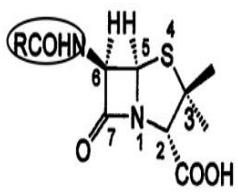</td><td colspan="2">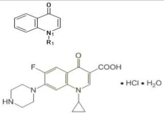</td><td colspan="2">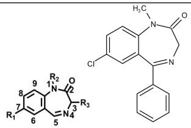</td><td>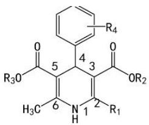</td></tr><tr><td>阿昔洛韦:【鸟嘌呤环】</td><td colspan="2">氯丙嗪:【吩噻嗪环】</td><td colspan="2">氢化可的松【孕甾烷】</td><td>环丙二酰脲(巴比妥)</td></tr><tr><td>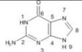鸟嘌呤(琥珀并琥唑)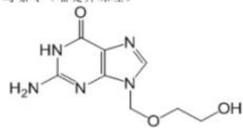</td><td colspan="2">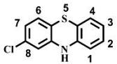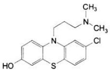</td><td colspan="2">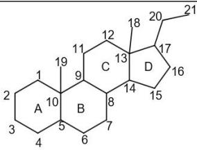</td><td>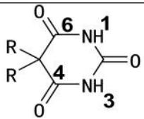</td></tr><tr><td>阿托伐他汀:【吡咯环】</td><td colspan="2">洛伐他汀、辛伐他汀【六氢萘环】</td><td colspan="2">氟伐他汀【吲哚环】</td><td>瑞舒伐他汀【嘧啶环】</td></tr><tr><td>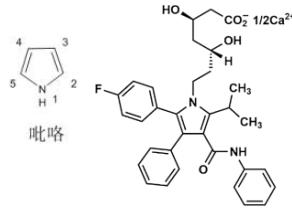</td><td colspan="2">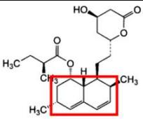 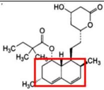</td><td colspan="2">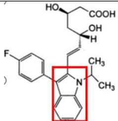</td><td>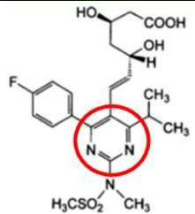</td></tr><tr><td>格列本脲:【苯磺酰脲】</td><td colspan="2">吗啡3位羟基甲基化生成:可待因</td><td colspan="3">N-甲基被烯丙基取代的吗啡受体拮抗剂:纳洛酮、烯丙吗啡</td></tr><tr><td>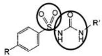磺酰脲类基本结构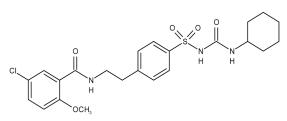</td><td colspan="2">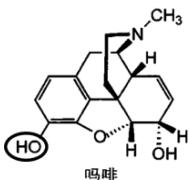 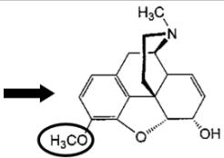可待因</td><td>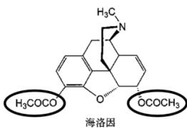</td><td>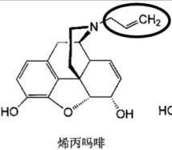</td><td>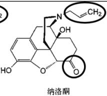</td></tr><tr><td colspan="6"></td></tr><tr><td colspan="2">麻黄碱</td><td colspan="3">1,2-苯并噻嗪结构药物:美洛昔康 吡罗昔康</td><td>西咪替丁:【咪唑】+【含硫醚】+【氰基胍】</td></tr><tr><td colspan="2">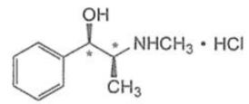</td><td colspan="3">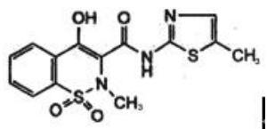 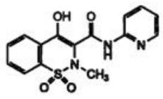</td><td>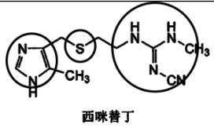</td></tr><tr><td colspan="2">质子泵抑制剂组成三部分:【吡啶环】+【亚磺酰基】+【苯并咪唑】</td><td>卡托普利:唯一含巯基的ACEI类</td><td colspan="2">含磷酰基的ACE抑制剂:福辛普利</td><td>氯沙坦分子结构:联苯+四氮唑+咪唑</td></tr><tr><td colspan="2">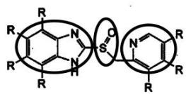</td><td>卡托普利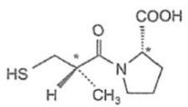</td><td colspan="2">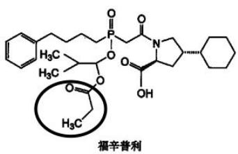</td><td>氯沙坦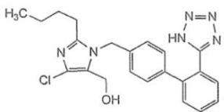</td></tr><tr><td colspan="2">缬沙坦分子结构中不含有咪唑</td><td>索他洛尔含有苯乙醇胺类结构,具有阻断β受体和延长心肌动作电位的双重作用</td><td colspan="2">4位C非手性,3,5位酯基完全相同,只有【硝苯地平】</td><td>氨氯地平:2,6位不同,2位合有氨基醚苯环2'位C1取代</td></tr><tr><td colspan="2">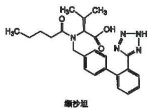</td><td>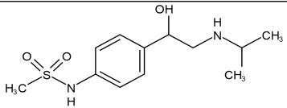</td><td colspan="2">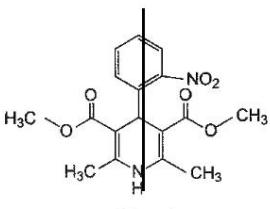硝苯地平</td><td>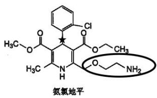</td></tr><tr><td colspan="2">华法林钠结构中含有一个手性碳</td><td>头孢菌素类抗菌活性药效团:β内酰胺环+氢化噻嗪</td><td colspan="2">青霉素类抗菌活性药效团:β内酰胺+四氢噻唑</td><td>青霉素母核6位引入吸电子作用的【苯氧乙酰氨基】得到非奈西林【耐酸,可口服】</td></tr><tr><td colspan="2">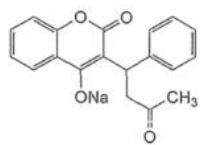</td><td>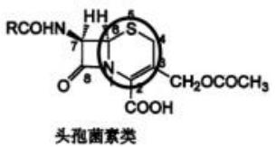</td><td colspan="2">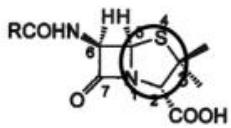青霉素类</td><td>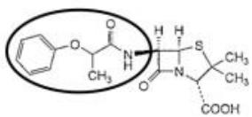</td></tr><tr><td colspan="2">青霉素母核6位引入【3-苯基-5-甲基异噁唑】得到苯唑西林【耐青霉素酶】</td><td>青霉素母核6位引入【苯甘氨酸】得到氨苄西林【口服、广谱】</td><td colspan="2">【单环β内酰胺】类抗生素:氨曲南______</td><td>喹诺酮类的【必须】药效团:3-羧基4-羰基【与金属离子络合】______</td></tr><tr><td colspan="2">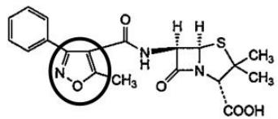</td><td>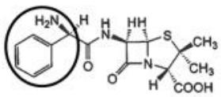氨苄西林</td><td colspan="2">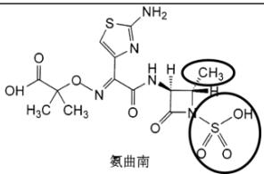</td><td>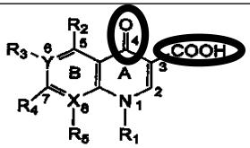</td></tr><tr><td colspan="2">【第一个引入F原子】的喹诺酮类:诺氟沙星</td><td>洛美沙星8位引入的氟原子:提高了生物利用度,但增加了光毒性______</td><td colspan="2"></td><td></td></tr><tr><td colspan="2">诺氟沙星</td><td>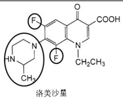</td><td colspan="2"></td><td></td></tr></table>

西药一计算公式会识别

<table><tr><td>药品有效期</td><td>公式:t0.9 = 0.1054/k</td></tr><tr><td>药物半衰期</td><td>公式:t1/2 = 0.693/k</td></tr><tr><td>酸性药物:</td><td>lg([HA]/[A−]) = pKa − pH</td></tr><tr><td>碱性药物:</td><td>lg([B]/[HB+]) = pH − pKa</td></tr><tr><td>单室模型静脉注射给药</td><td>lgC = −(k/2.303)t + lgC0单室静注只有κ,还有初始给药C0</td></tr><tr><td>单室模型静脉滴注</td><td>C = k0/(kV) · (1 − e−α)单室静脉找K0和K</td></tr><tr><td>单室模型血管外给药</td><td>C = kaFX0/[V(ka−k)] · (e−kt − e−kat)血管外给药必有吸收系数F,还有吸收速率常数Ka和消除速率常数K</td></tr><tr><td>双室模型静脉注射</td><td>C = X0(α−k21)/[Vc(α−β)] · e−αt + X0(k21−β)/[Vc(α−β)] · e−βt简化后:C = Ae−αt + Be−βtα:分布速度常数或快配置速度常数;β:消除速度常数或慢配置速度常数。看到α和β为双室</td></tr><tr><td>双室模型血管外给药</td><td>C = Ne−kat + Le−at + Me−βt</td></tr><tr><td>非线性</td><td>−dC/dt = VmC/(Km+C)米氏方程:Vm为药物消除过程的理论最大速度;Km为Michaelis常数,简称米氏常数。是指药物消除速度Vm一半时的血药浓度。</td></tr><tr><td>静脉滴注半衰期个数与达坪浓度分数的关系</td><td>半衰期个数6.64---达坪浓度99半衰期个数3.32--达坪浓度90</td></tr><tr><td>绝对生物利用度</td><td>F = [AUC(po)/Dose(po)] ÷ [AUC(iv)/Dose(iv)] × 100%</td></tr><tr><td>相对生物利用度</td><td>Fr = [AUC(T)/Dose(T)] ÷ [AUC(R)/Dose(R)] × 100%</td></tr></table>

